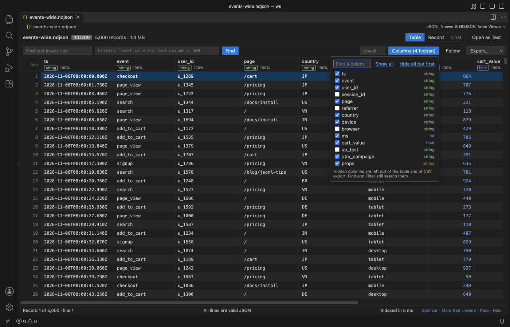
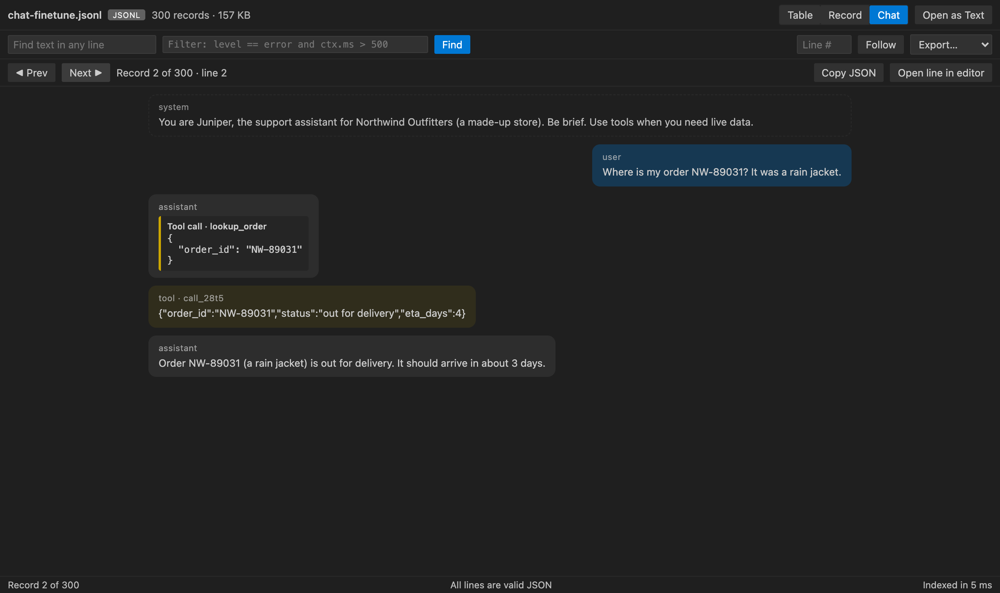
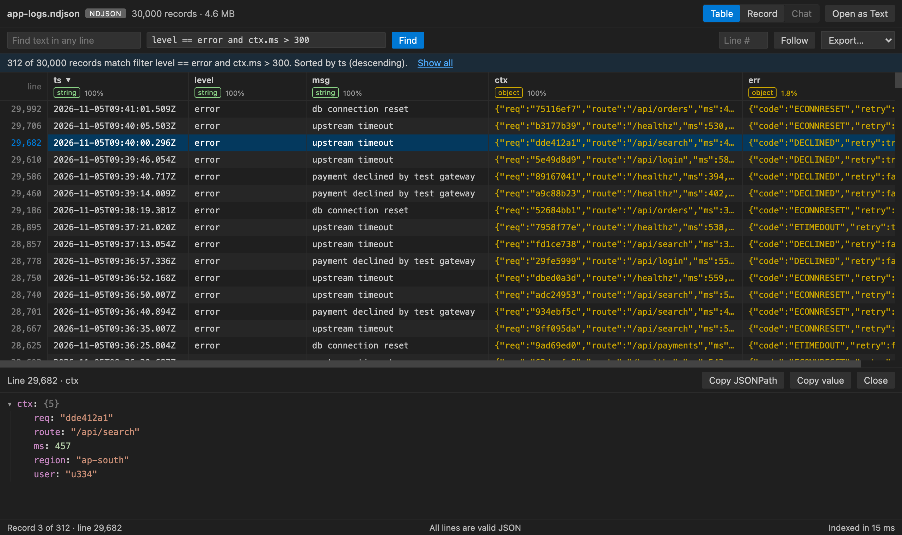
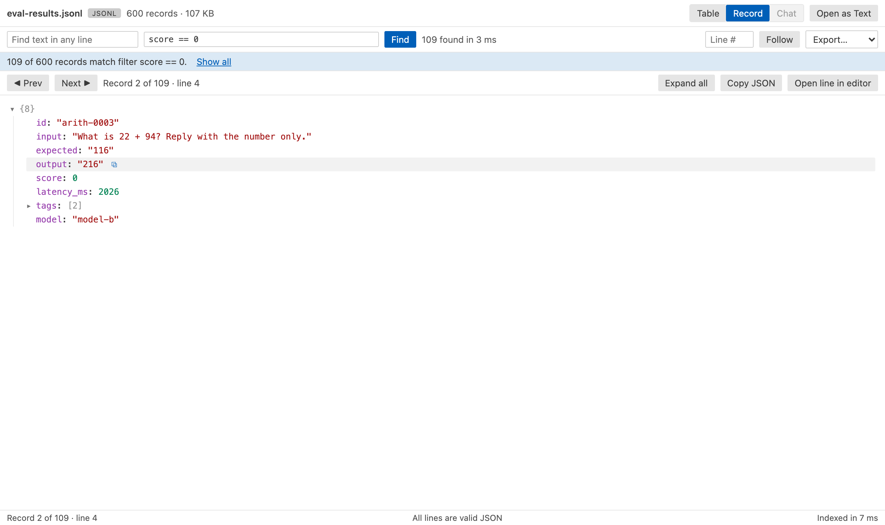
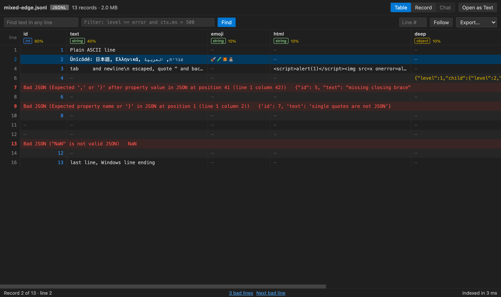
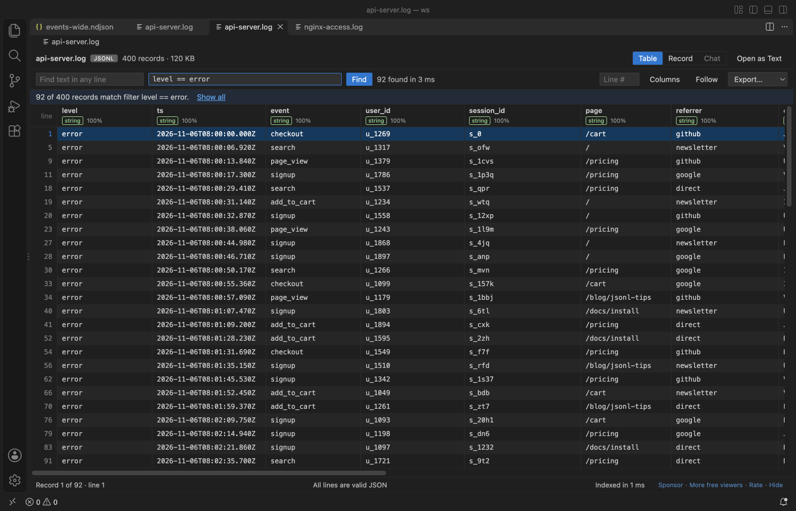

# JSONL Viewer & NDJSON Viewer (JSONL Table)

A JSONL viewer and NDJSON viewer for VS Code. Open any `.jsonl`, `.ndjson` or `.jsonl.gz` file as a table, a record tree or a chat transcript, with the first rows on screen before the rest of the file is read.

| Chat view of a fine-tuning set | Table with a filter, a sort and one cell opened |
|---|---|
|  |  |

| Record tree with copy JSONPath | Bad lines marked with their line numbers |
|---|---|
|  |  |

*Real output. The Columns and .log pictures are a real VS Code window (1.142) with the packaged extension. The others are the extension's own webview page, with its Content Security Policy, fed by its real indexer and message protocol and captured in headless Chrome. The files are generated by `scripts/make-samples.js`, so no real logs or datasets appear.*

- It stays fast on big files. The extension reads the file as a stream and keeps only one number per line (where that line starts). The webview gets 200 rows at a time and never sees the whole file. In the test suite a 40 MB file with 360,000 lines shows its first page in about 20 ms.
- It reads LLM data the way you think about it. Files with `messages` (OpenAI), `conversations` (ShareGPT), `contents` (Gemini), `role` and `content` lines, or `prompt` and `completion` pairs open as a chat. Tool calls, tool results and thinking blocks get their own boxes.
- It fits the table to your data. Click Columns to hide the keys you don't need, drag a column edge to make it wider or narrower, and the tab remembers both. CSV export then saves only the columns you see. Any file can open as JSON Lines, so `.log` files and exports saved as `.json` or `.txt` get the same table.
- It finds what you need across the whole file. Type text, or a filter such as `level == error and ctx.ms > 500`, and press Enter. The search runs in the background with a progress count and a Cancel button. Then sort, export the matches, or follow new lines as a log grows.

## Quick start

1. Install JSONL Viewer and click any `.jsonl`, `.ndjson`, `.jsonlines` or `.jsonl.gz` file.
2. Switch between Table, Record and Chat at the top right. Press Enter in the Find or Filter box to search.

To edit the raw text, click Open as Text. Run "JSONL Viewer: Get Started" for a short tour.

## What you can do

The table makes one column per top-level key, from the first 1,000 records. Each header shows the type (`string`, `int`, `float`, `bool`, `object`, `array` or `mixed`) and how many of those records fill that key. Click a header to sort the whole view. Clicks cycle through ascending, descending and file order, and missing values go last. Click a cell to open its value as a tree below the table. Double-click a row, or press Enter, to open the record.

Click Columns above the table to pick which columns show. The list has a find box for wide files, Show all, and Hide all but first. Drag the right edge of a column header to change its width, or double-click the edge to fit it again. Hidden columns and widths stay with the tab while it is open. Find and Filter still search hidden columns, and CSV export leaves them out.

To read a log or an export that isn't named `.jsonl`, right-click it in the Explorer (`.log`, `.json`, `.txt`, `.out` and `.data` files) or its editor tab and pick "Open as JSON Lines (any file)". The same command is in the Command Palette for any file. If none of the first lines is valid JSON, a note says so and offers Open as Text, so you never get an empty page.

The record view shows one record as a tree that opens two levels deep. Hover any line and click the small copy button to copy its JSONPath, such as `$.messages[2].content`. Copy JSON copies the whole record. Open line in editor jumps to that line in the text editor, beside the viewer. Use the arrow keys, or J and K, to move between records.

The filter language is short. `key == value`, `key != value`, `>`, `>=`, `<`, `<=`, `key contains text`, `key !contains text`, `key =~ regex`, `key exists` and `key missing` all work, joined with `and`. Nested keys look like `ctx.user.id` or `tags[0]`, and quoted keys like `["odd key"]`. Find matches text anywhere in the raw line and ignores case.

Lines that aren't valid JSON show in red with their line number and the parser's message. The status bar counts them. Click the count to see only bad lines, or Next bad line to step through them.

When a file grows, new records show up within about two seconds. Turn on Follow to keep the newest record in view. A search or filter that's open picks up new matches too. If the file is replaced by a shorter one, the viewer reloads it.

Export saves the records in view, after Find, Filter and sort, as CSV, a JSON array or JSON Lines. Lines that aren't valid JSON are skipped, and the message tells you how many.

## Limits

| What | Limit |
|---|---|
| File size | Under 4 GB. Bigger files show a message and an Open as Text button. |
| One line | Lines over 5 MB show as truncated in the table and the record view. Open the line in the editor to see all of it. |
| `.jsonl.gz` | Unpacked in memory up to 512 MB. Past that, the first 512 MB is shown with a note. Live tail is off for packed files. |
| Remote files (virtual workspaces) | Read whole, up to 256 MB. |
| Sort | Up to 2,000,000 records in view. Filter first for bigger files. |
| Columns | From the first 1,000 records. Keys that appear only later still show in the record view. |

Find works on the raw text of each line, so it won't match a character that the file stores as a `\u` escape. Use a filter with `contains` for that, since filters read the parsed values.

## Privacy

JSONL Viewer runs offline. It makes no network calls and has no telemetry. The webview runs under a strict Content Security Policy with no remote scripts, and file content goes into the page only as text, never as HTML.

## Settings

| Setting | Default | What it does |
|---|---|---|
| `jsonlViewer.liveTail` | `true` | Add new records while the file grows |
| `jsonlViewer.askForRating` | `true` | Ask one time for a Marketplace rating, after 5 files and 2 days. Turn it off with `false` |

## Using it with Agent Session Viewer

If you also have Agent Session Viewer installed, VS Code asks which editor should open Claude Code and Codex session files. Pick "Configure Default" once and choose the one you want. Other .jsonl files always open in JSONL Viewer.

## Support Zovo

Zovo extensions are free, with no ads and no tracking. They are made by [theluckystrike](https://github.com/theluckystrike) on GitHub. If this one saves you time, you can support the work:

- [Sponsor on GitHub](https://github.com/sponsors/theluckystrike)
- [Follow theluckystrike on GitHub](https://github.com/theluckystrike)

## More tools by Zovo

- [Large JSON Viewer & JSON Tree](https://marketplace.visualstudio.com/items?itemName=zovo.zovo-json-tree-viewer) shows large JSON files as a searchable tree, copies JSONPath and turns arrays of objects into a table.
- [CSV Viewer, Excel Viewer (XLSX) & Parquet Viewer](https://marketplace.visualstudio.com/items?itemName=zovo.table-viewer-vscode) opens CSV, TSV, Excel and Parquet files as a sortable, filterable table.
- [Avro Viewer, Arrow Viewer & Feather Viewer](https://marketplace.visualstudio.com/items?itemName=zovo.arrow-avro-viewer) opens Avro, Arrow and Feather files as a paged table.
- [Claude Code History & Codex History Viewer](https://marketplace.visualstudio.com/items?itemName=zovo.agent-session-viewer) browses and searches your local Claude Code and Codex sessions.
- [SQLite Viewer & DB Viewer (Read-Only)](https://marketplace.visualstudio.com/items?itemName=zovo.sqlite-table-viewer) browses SQLite tables read-only and runs SELECT queries.

See [all Zovo extensions on the Marketplace](https://marketplace.visualstudio.com/publishers/zovo).

## License

MIT. Gzip support uses [fflate](https://github.com/101arrowz/fflate) (MIT).
